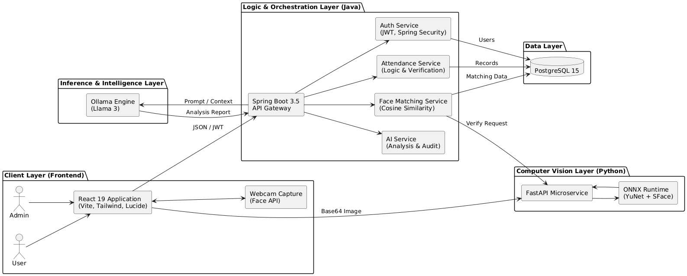

# AttendIQ: AI-Powered Smart Attendance System

AttendIQ is a next-generation attendance management platform that leverages **Biometric Face Recognition**, **AI-driven Fraud Detection**, and **Predictive Analytics** to eliminate proxy attendance and provide deep insights into student engagement.

---

## Key Features

*   **Biometric Face Recognition**: Sub-100ms face verification using ONNX deep learning models.
*   **AI Fraud Detection**: Intelligent analysis of confidence scores, location data, and device IDs to flag suspicious attempts.
*   **Real-time Analytics**: Dynamic dashboards for Admins, Teachers, and Students powered by Llama 3.
*   **Attendance Kiosk Mode**: A dedicated, non-authenticated interface for lightning-fast classroom check-ins.
*   **Role-Based Access Control**: Highly secure authentication system with JWT and distinct portals for different user roles.
*   **Premium Glassmorphism UI**: A stunning, modern, and responsive interface designed for high-performance usability.

---

## Technology Stack

### **Frontend**
*   **React 19 & Vite**: Modern, high-performance UI library and build tool.
*   **Tailwind CSS**: Utility-first CSS framework for rapid UI development.
*   **Lucide React**: Beautifully crafted icons for modern dashboards.
*   **Axios**: Promise-based HTTP client for API communication.
*   **React Router Dom**: Client-side routing for seamless navigation.

### **Backend (Core)**
*   **Java 21 & Spring Boot 3.5**: Robust, enterprise-grade backend infrastructure.
*   **Spring Security & JWT**: State-of-the-art authentication and authorization.
*   **Spring Data JPA**: Efficient database abstraction and ORM.
*   **PostgreSQL**: Reliable, high-performance relational database.
*   **SpringDoc OpenAPI**: Automatic API documentation (Swagger).

### **AI & Machine Learning**
*   **FastAPI (Python)**: High-performance microservice for face embedding extraction.
*   **ONNX Runtime**: Optimized execution of deep learning models (YuNet & SFace).
*   **Ollama (Llama 3)**: Locally hosted LLM for predictive attendance analysis.
*   **OpenCV**: Computer vision library for image processing.

---

## System Architecture

1.  **Client (React)**: Captures face images and manages the user interface.
2.  **Auth Service (Spring Boot)**: Handles user registration, login, and secure token management.
3.  **Python Face Microservice**: Processes raw images to extract 128-dimensional biometric embeddings.
4.  **Java Backend (Spring Boot)**: Orchestrates attendance logic, biometric matching, and AI security auditing.
5.  **AI Analysis (Ollama)**: Performs deep scans of attendance trends using Large Language Models.

---

## System Architecture



---

## 🚦 Getting Started

### **Prerequisites**
*   Java 21 JDK
*   Node.js 18+
*   Python 3.10+
*   PostgreSQL 15+
*   Ollama (with `llama3` installed)

### **1. Setup Python Service**
```bash
cd python_service
pip install -r requirements.txt
python api.py
```

### **2. Setup Java Backend**
*   Create a PostgreSQL database named `attendiq`.
*   Configure `application.yml` with your database credentials.
*   Run Maven install and start the application.

### **3. Setup Frontend**
```bash
cd client
npm install
npm run dev
```

### **4. Start AI Engine**
Ensure Ollama is running and start the Llama 3 model:
```bash
ollama run llama3
```

---

## Authors

*   **Mahesh Shinde** - *Developer & Architect*

---

## License

This project is licensed under the MIT License - see the LICENSE file for details.
